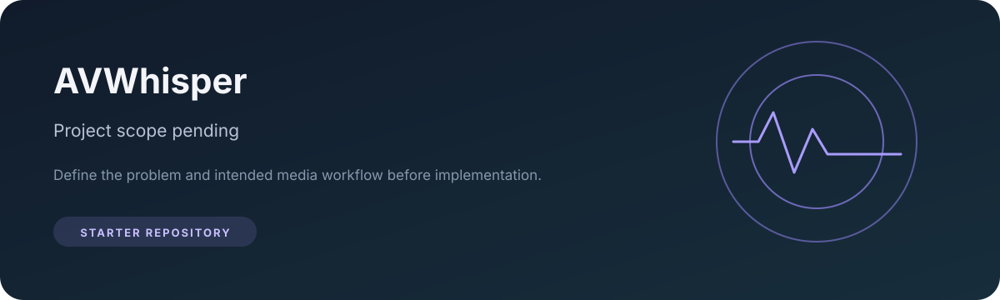

# AVWhisper

A repository reserved for a future audio/video project.

## Status

This repository is currently empty of implementation code. Its name alone does not define the intended product, supported media, target users, or technical approach, so this README does not claim specific functionality.

## Before implementation

Define the project scope, then document:

- Supported input formats and expected outputs.
- Installation and a minimal runnable example.
- Architecture and major dependencies.
- Privacy, copyright, and data handling expectations for media.
- Validation approach and known limitations.

## Contributing

Open an issue to propose the project scope or a feature before submitting a substantial implementation.

## License

No license file is currently listed. Contact the repository owner before reusing or redistributing material from this repository.
